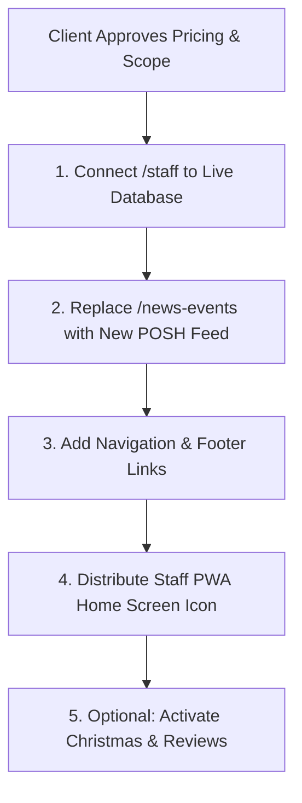

# The Ship Inn - Hidden Features & Production Go-Live Roadmap

This document provides a complete audit of all **staged, hidden, and unlinked features** currently on the website codebase, their current URLs, how they work, and the exact steps needed to activate them on the public live site in the future.

---

## 1. Inventory of Hidden / Staged Routes

| Feature / Page | Staged URL | Current State | Target Public Destination |
| :--- | :--- | :--- | :--- |
| **Mobile CMS & Facebook Reels ("POSH") Client Pitch** | `/demo-posh-7924` | Active staged mockup with live feed, auto-archive tabs, video player & commercial pitch | Replace `/news-events` |
| **Staff Mobile PWA Publisher** | `/staff` | Protected by 4-digit PIN (`1572`), camera roll uploader, Silent Mode, live item management | Keep at `/staff` or `/admin/publisher` with home screen icon |
| **Shared Demo Data API** | `/api/demo-posh` | Reads/writes to `content/demo-posh-items.json` | Migrate to live Outstatic / Database API |
| **Christmas & Festive Dining Experience** | `/xmas-preview-7924` and `/xmas-preview-7924/christmas` | Fully designed Christmas festive menu & booking landing page | Link to main menu or `/christmas` |
| **Live Reviews & Testimonials Carousel / Grid** | `/demo-testimonials-7924` | Customer reviews, star ratings, photo attachments & moderation admin | Embed on `/` (Homepage) & `/reviews` |
| **Guest Review Submission Modal & API** | `/review` & `/api/reviews/submit` | Fully functional guest review submission form with photo uploads | Live navigation link or QR code on pub tables |

---

## 2. Details of Each Staged Feature

### A. Mobile CMS & Facebook Reels Engine ("POSH" Pipeline)
* **What is built:**
  * Universal social video player (`SocialVideoEmbed.tsx`) that embeds Facebook Reels, Instagram Reels, YouTube Shorts, and native camera roll video uploads (`.mp4`, `.mov`).
  * Uncropped adaptive flyer container with ambient blurred backdrop that guarantees 100% of event posters (square, circular, portrait, landscape) display without cutting off text.
  * Three tabs: **Upcoming Events**, **News & Updates**, and **Past Events (Auto-Archive)**.
  * Schema.org/Event structured data for Google Search Event Carousel.
  * Open Graph social card preview for Facebook.
* **Why it's hidden:** Staged with `robots: noindex` on `/demo-posh-7924` so you can demonstrate the workflow to the client and agree on pricing without altering the public live site.

### B. Staff Mobile PWA (`/staff`)
* **What is built:**
  * Clean, off-white heritage pub design matching The Ship Inn’s official crest (`/images/the_ship_inn2.webp`).
  * 4-digit PIN lock screen (default PIN: `1572` or `7924`).
  * Installable as a home screen app icon (PWA) with zero browser URL bar.
  * Category toggle: **Scheduled Event** (with date & time) vs. **Pub News / Special** (daily blackboard menu, seasonal ales, weather).
  * Direct camera roll video upload with **Silent Video Mode** toggle to eliminate Meta copyright blocks.
  * Built-in client-side WebP image optimizer (compresses 10MB phone photos down to ~150KB in 0.5s).
  * 1-click **"Copy Facebook Link"** dialog.
  * Live post deletion so staff can remove cancelled events or daily specials in one tap.

### C. Christmas & Festive Page (`/xmas-preview-7924`)
* **What is built:**
  * Full festive menu showcase (turkey roast, Porlock Bay oysters, Christmas puddings).
  * Booking inquiry form with automated festive dates and party sizes.
* **Current status:** Hidden behind the preview URL until festive bookings open.

### D. Guest Review & Testimonials Engine (`/review` & `/admin/testimonials`)
* **What is built:**
  * Guest-facing submission page with star rating, date of visit, and multiple photo uploads.
  * Admin moderation dashboard (`/admin/testimonials`) to approve, edit, or reject reviews.
  * Live responsive testimonial carousel with full text expansion and photo thumbnail viewing.

---

## 3. What Needs to Be Altered to "Go Live" in the Future

When the client approves the pricing and gives the green light to launch, here are the exact steps to transition each feature from "Demo" to "Live Public":

### Step 1: Connect Staff Publisher to Live Database
* **Current state:** `/staff` saves to `content/demo-posh-items.json` via `/api/demo-posh` so it updates the demo page instantly without touching live content.
* **Changes needed:**
  1. Update `src/app/api/staff/publish/route.ts` to save markdown files into `content/events/` and `content/news/` (or Outstatic/GitHub API).
  2. For video files: connect to cloud storage (e.g. Vercel Blob, Cloudinary, or AWS S3) for permanent hosting of staff camera roll videos.

### Step 2: Replace Public `/news-events` Page
* **Current state:** Public `/news-events` is the old static Outstatic list.
* **Changes needed:**
  1. Replace `src/app/(website)/news-events/page.tsx` with the new interactive card layout from `/demo-posh-7924`.
  2. Enable the **Universal Video Player** (`SocialVideoEmbed`) on the public feed.
  3. Ensure the dynamic tabs (**Upcoming Events**, **News & Updates**, **Past Events**) read from the live published content.

### Step 3: Add Navigation & Staff Access
* **Staff Access:** Provide pub management with the permanent link `https://theshipinnporlockweir.co.uk/staff` and guide them to tap "Add to Home Screen".
* **PIN Customization:** Update the staff PIN in environment variables (`STAFF_PIN=XXXX`) rather than hardcoded defaults.

### Step 4: Activating Christmas Page (Seasonal)
* **Changes needed:**
  1. Change route from `/xmas-preview-7924/christmas` to `/christmas`.
  2. Add "Christmas at The Ship" banner/CTA to the homepage navigation and hero carousel.

### Step 5: Activating Testimonials & Reviews
* **Changes needed:**
  1. Embed `<TestimonialCarousel />` into `src/app/(website)/page.tsx` (Homepage).
  2. Print table cards with QR codes pointing to `https://theshipinnporlockweir.co.uk/review` so guests can upload photos and leave reviews after dining.

